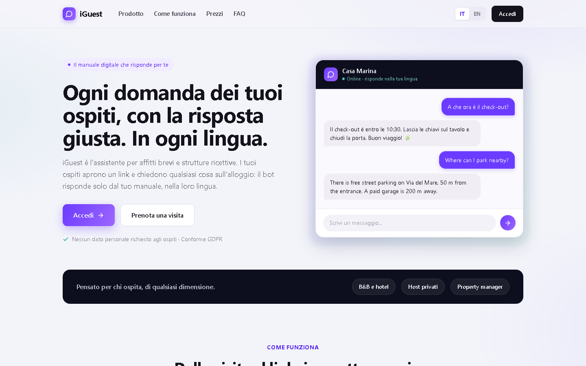
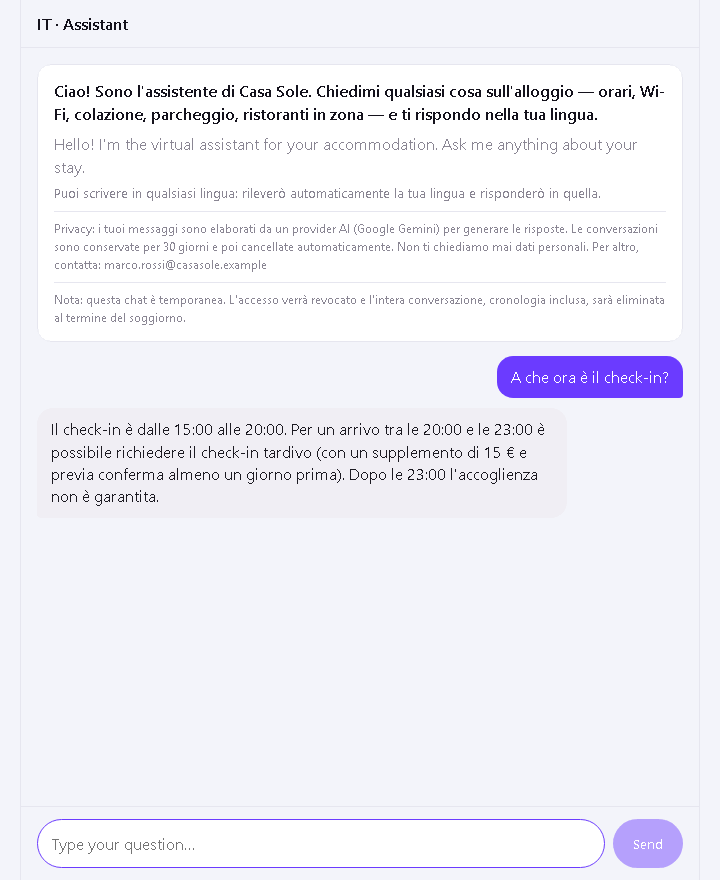
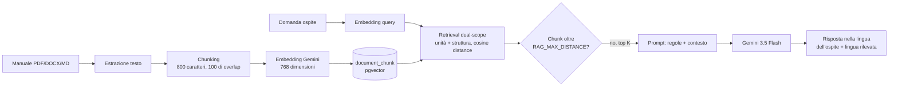
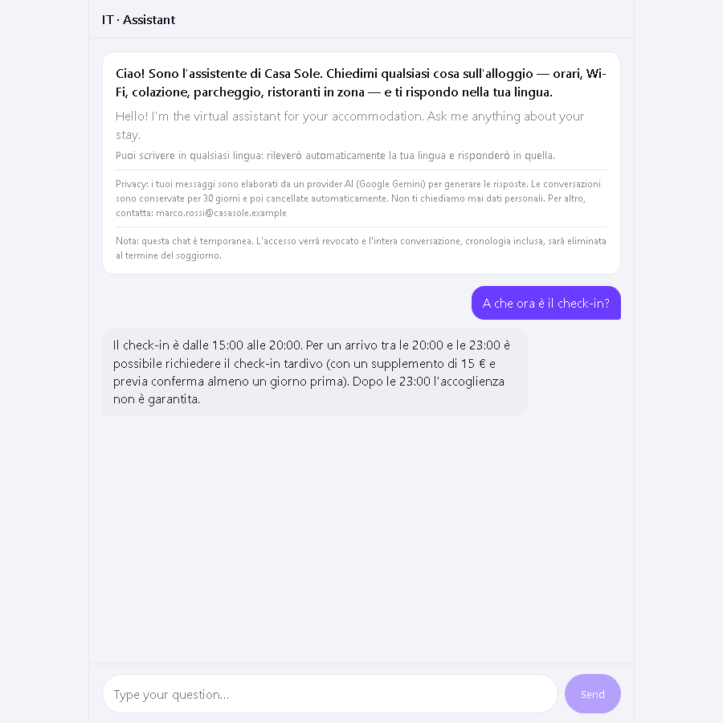
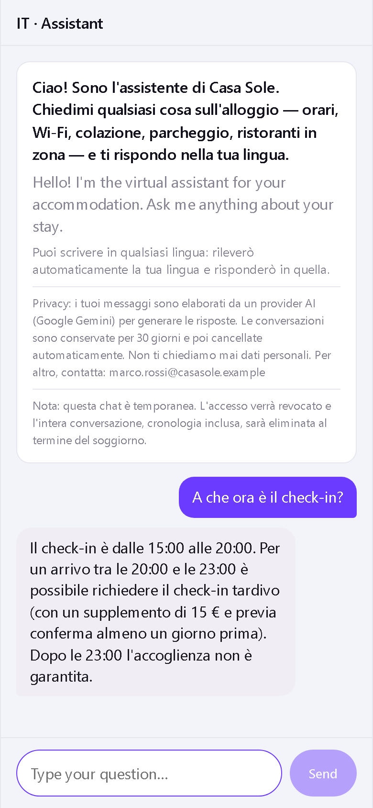
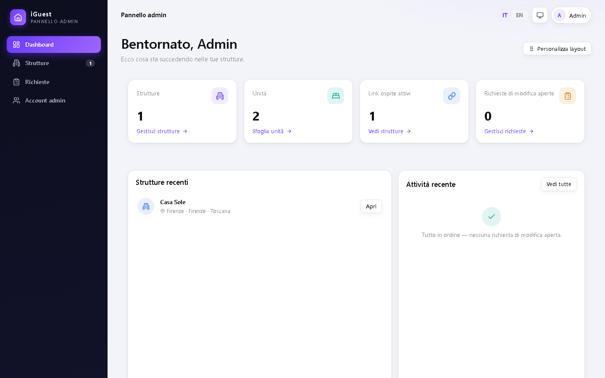
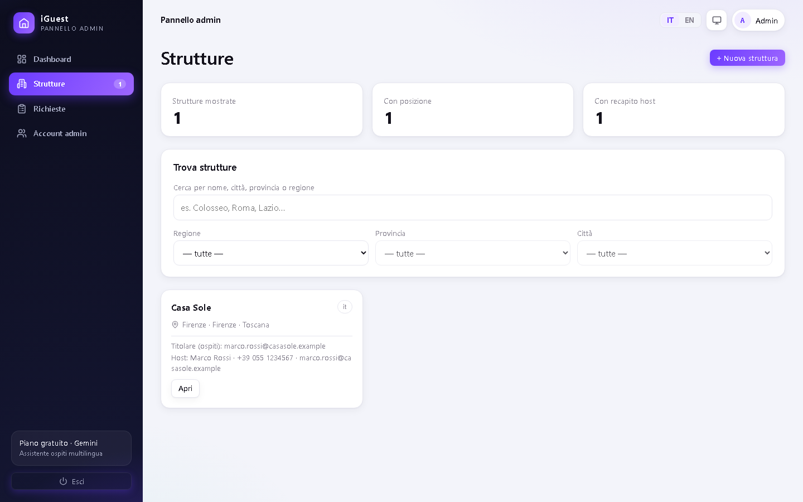
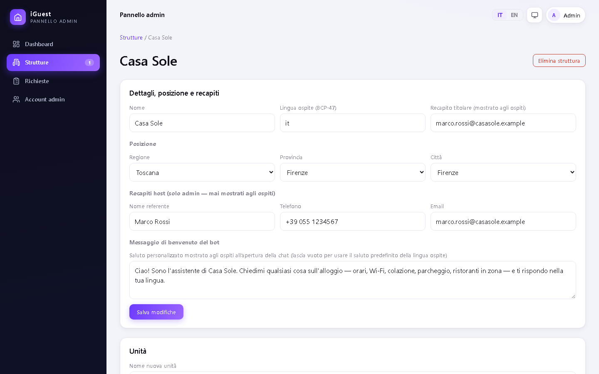
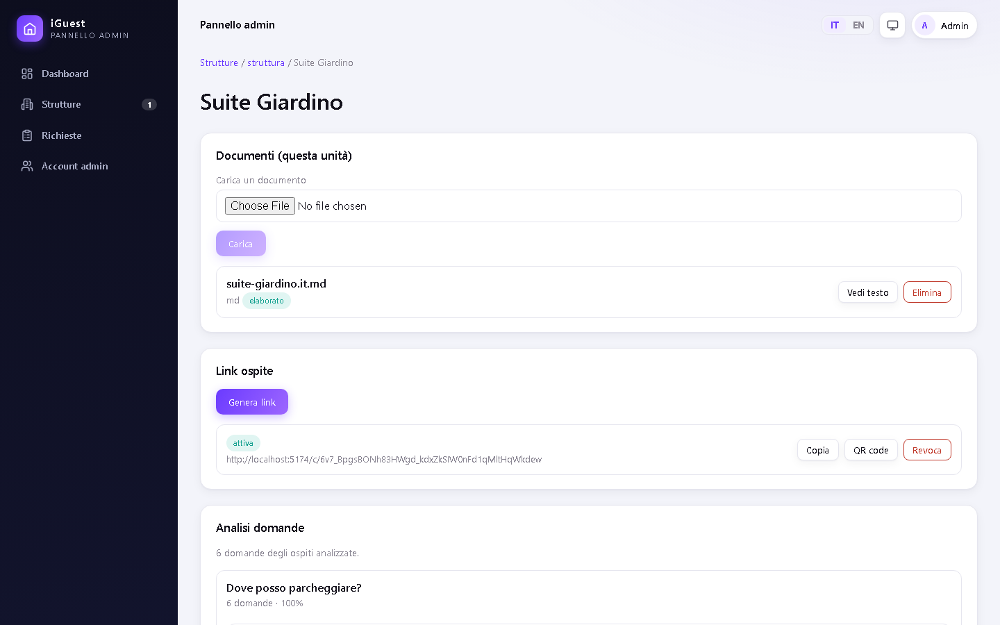

# iGuest

**Chatbot RAG multilingua per ospiti di affitti brevi.** L'ospite apre un link
univoco, chiede qualsiasi cosa sull'alloggio e riceve una risposta nella sua
lingua, generata **solo** dal manuale digitale della struttura. Un pannello admin
gestisce strutture, unità, documenti, link e conversazioni; un portale host dà al
gestore una vista in sola lettura su documenti, FAQ e analytics.

Progetto realizzato durante un corso di Generative AI / vibe coding, con vincolo
di **budget zero**: solo strumenti gratuiti e open source.




<p align="center">
  
</p>

---

## Indice

1. [Cosa fa](#cosa-fa)
2. [Come funziona il RAG](#come-funziona-il-rag)
3. [Avvio rapido](#avvio-rapido)
4. [Dati demo inclusi](#dati-demo-inclusi)
5. [Screenshot](#screenshot)
6. [Struttura del progetto](#struttura-del-progetto)
7. [Configurazione](#configurazione)
8. [API](#api)
9. [Test e controlli](#test-e-controlli)
10. [Privacy e GDPR](#privacy-e-gdpr)
11. [Note e limiti noti](#note-e-limiti-noti)
12. [English summary](#english-summary)

---

## Cosa fa

- **Chat ospite via link** — un capability URL per prenotazione, senza login e
  senza dati personali; il token è casuale (256 bit) e revocabile in un clic.
- **Risposte solo dal manuale** — niente invenzioni: se l'informazione non c'è,
  il bot lascia il recapito del titolare; le domande fuori tema vengono declinate.
- **Multilingua reale** — la domanda può essere in italiano, inglese, francese,
  arabo o giapponese: il modello legge il contesto in qualsiasi lingua e risponde
  in quella dell'ospite.
- **Ingestion documenti** — PDF, DOCX, TXT, MD, CSV, HTML → testo → chunk →
  embedding Gemini → `pgvector`. Il testo estratto resta leggibile anche se
  l'indicizzazione fallisce.
- **Pannello admin** — strutture con ricerca/filtri geografici, unità, documenti,
  link ospite con QR code, conversazioni (con cancellazione GDPR), host, account
  admin, inbox richieste, analytics delle domande e statistiche.
- **Portale host** — documentazione della struttura in sola lettura, FAQ,
  analytics per unità, richieste di modifica all'admin, notifiche e profilo.
- **Landing pubblica IT/EN** — sito vetrina con anteprima chat e form
  "Prenota una visita" i cui lead finiscono nell'inbox admin.
- **Analytics automatiche** — le domande degli ospiti sono raggruppate per
  similarità e le più frequenti diventano FAQ, ricalcolate in background.
- **GDPR by design** — nessun dato personale richiesto, retention configurabile
  (default 30 giorni), purga pianificata, diritto all'oblio.

## Come funziona il RAG



Tre scelte che fanno la differenza:

1. **Retrieval dual-scope** — per un'unità si cercano i suoi chunk *più* quelli
   condivisi della struttura (`unit_id IS NULL`), così regole della casa e guida
   alla zona valgono per ogni stanza senza duplicare i documenti.
2. **Soglia di distanza** (`RAG_MAX_DISTANCE`) — i chunk poco pertinenti vengono
   scartati: su manuali grandi la coda del top-K è rumore e il modello tende a
   cucire risposte da sezioni sbagliate.
3. **Prompt con regole esplicite** — lingua dell'ospite, solo contesto fornito,
   traduzione di un contesto in lingua diversa, fallback sul recapito del
   titolare, rifiuto cortese per domande fuori tema, mai chiedere dati personali.
   La risposta è richiesta in JSON (`answer`, `detected_language`).

Il messaggio dell'ospite è salvato **prima** della chiamata al modello: un rate
limit o un timeout non fa perdere la domanda, che resta disponibile per analytics
e FAQ.

## Avvio rapido

Prerequisiti: Docker Desktop, una chiave Gemini gratuita da
[Google AI Studio](https://aistudio.google.com/). Python 3.11+ e Node 18+ servono
solo per eseguire i processi fuori da Docker.

```bash
# 1. configurazione (la chiave NON va committata)
cp backend/.env.example backend/.env
#    imposta GEMINI_API_KEY, ADMIN_USERNAME, ADMIN_PASSWORD, ADMIN_JWT_SECRET

# 2. avvio: database + backend + frontend
docker compose up --build -d

# 3. dati demo (struttura, 2 unità, 4 manuali, link ospite)
docker compose exec backend python scripts/seed_demo.py --reset
```

Il seed stampa un link tipo `http://localhost:5174/c/<token>`: aprilo e prova la
chat. Servizi disponibili:

| URL | Cosa |
|-----|------|
| <http://localhost:5174/> | Landing pubblica (IT/EN) con form "Prenota una visita" |
| `http://localhost:5174/c/<token>` | Chat ospite (link stampato dal seed) |
| <http://localhost:5174/admin> | Pannello admin (login da `backend/.env`) |
| <http://localhost:5174/host> | Portale host |
| <http://localhost:8000/docs> | Documentazione API (Swagger) |
| <http://localhost:8000/health> | Health check |

Backend e frontend montano il codice come volume: le modifiche si ricaricano a
caldo. Il rebuild serve solo quando cambiano le dipendenze. Per fermare tutto:
`docker compose down` (`-v` cancella anche il volume del database).

### Senza Docker per backend/frontend

```bash
docker compose up -d db          # solo PostgreSQL + pgvector

cd backend
python -m venv .venv && .venv\Scripts\activate     # macOS/Linux: source .venv/bin/activate
pip install -r requirements.txt
alembic upgrade head
uvicorn app.main:app --reload --port 8000

cd frontend && npm install && npm run dev          # http://localhost:5173
```

## Dati demo inclusi

La cartella [`samples/`](samples/README.md) contiene i manuali **fittizi** di
*Casa Sole*, un B&B a Firenze con due unità. Sono scritti apposta in due lingue
per verificare il comportamento cross-lingua del RAG.

| File | Scope | Contenuto |
|------|-------|-----------|
| `house-rules.it.md` | struttura | check-in/out, Wi-Fi, colazione, silenzio, animali, parcheggio, rifiuti, sicurezza |
| `local-guide.it.md` | struttura | trasporti, ristoranti, supermercati, musei, numeri utili |
| `suite-giardino.it.md` | unità (IT) | dotazioni, cucina, doccia, cassaforte, checklist di check-out |
| `olive-room.en.md` | unità (EN) | manuale della Camera Oliva in inglese |

Il seed ingerisce i quattro file con gli embedding reali (29 chunk) e crea il link
ospite. Esempi di risposte verificate con il demo in esecuzione:

| Domanda | Lingua | Risposta (estratto) |
|---------|--------|---------------------|
| *A che ora è il check-in?* | IT | «Il check-in è dalle 15:00 alle 20:00. Per un arrivo tra le 20:00 e le 23:00 è necessario richiedere il check-in tardivo (supplemento di 15 €)…» |
| *What's the Wi-Fi password?* | EN | «The Wi-Fi password is `oliva2026`. It is the same password for both the CasaSole-Guest network and the 5 GHz network (CasaSole-Guest-5G).» |
| *Dove posso parcheggiare?* | IT | «Ogni alloggio dispone di un posto auto gratuito in Via delle Rose 8, dietro il cancello bianco…» |

La seconda domanda è la prova del comportamento cross-lingua: domanda in inglese,
contesto (regole della casa) in italiano, risposta tradotta in inglese.

Per creare anche un account host durante il seed (password temporanea stampata una
sola volta):

```bash
docker compose exec backend python scripts/seed_demo.py --reset \
  --host-email host@casasole.example
```

Per caricare i tuoi documenti: pannello admin → struttura o unità → *Carica un
documento*. In alternativa `backend/scripts/demo_ingestion.py` ingerisce un
singolo file da riga di comando.

## Screenshot

| Chat ospite (desktop) | Chat ospite (mobile) |
|---|---|
|  |  |

La schermata di apertura è bilingue, avvisa che i messaggi sono elaborati da un
provider AI, indica la retention e il recapito del titolare, e ricorda che l'accesso
è temporaneo.

| Dashboard admin | Strutture |
|---|---|
|  |  |

| Dettaglio struttura | Dettaglio unità |
|---|---|
|  |  |

Nella pagina dell'unità convivono documenti (con anteprima del testo estratto),
link ospite con QR code, conversazioni e analytics delle domande. Tutte le
immagini sono catturate dall'app in esecuzione con i dati demo di `samples/`.

## Struttura del progetto

```text
iGuest/
├── docker-compose.yml           # db + backend + frontend (+ profilo prod nginx)
├── backend/
│   ├── app/
│   │   ├── main.py              # FastAPI + scheduler (retention, FAQ)
│   │   ├── config.py            # impostazioni da .env
│   │   ├── models/              # SQLAlchemy: strutture, unità, documenti, chat…
│   │   ├── routers/             # guest, admin, host, public, geo
│   │   ├── schemas/             # Pydantic (request/response)
│   │   ├── services/
│   │   │   ├── ingestion/       # conversione → chunking → embedding → pipeline
│   │   │   ├── rag/             # retrieval, prompt, generation, engine
│   │   │   ├── faq/             # clustering domande, analytics, FAQ
│   │   │   └── …                # auth, links, chat, retention, upload
│   │   └── data/geo_it.json     # comuni italiani per i filtri admin
│   ├── alembic/                 # migrazioni
│   ├── scripts/                 # seed_demo, demo_seed, purge, recompute_faqs
│   └── tests/                   # pytest: unit + flussi HTTP/DB
├── frontend/
│   ├── src/
│   │   ├── pages/               # landing, chat ospite
│   │   ├── admin/               # pannello admin
│   │   ├── host/                # portale host
│   │   ├── components/          # componenti condivisi
│   │   └── i18n/                # copy IT/EN della UI admin
│   └── nginx.conf               # SPA fallback per la build di produzione
├── samples/manuals/casa-sole/   # manuali demo (fittizi, IT + EN)
├── docs/
│   ├── ARCHITECTURE.md          # modello dati, pipeline, decisioni
│   ├── screenshots/             # immagini del README + GIF
│   └── notes/                   # note di sviluppo e devlog
└── backend/scripts/seed_demo.py # demo completa in un comando
```

Approfondimenti: [`docs/ARCHITECTURE.md`](docs/ARCHITECTURE.md) (modello dati,
pipeline, API, decisioni e compromessi) e [`samples/README.md`](samples/README.md).

## Configurazione

Tutte le impostazioni stanno in `backend/.env` (template completo in
[`backend/.env.example`](backend/.env.example)). Le principali:

| Variabile | Default | Ruolo |
|-----------|---------|-------|
| `GEMINI_API_KEY` | — | **obbligatoria**: embedding + generazione |
| `EMBEDDING_MODEL` | `models/gemini-embedding-001` | modello di embedding (768 dim) |
| `GENERATION_MODEL` | `models/gemini-3.5-flash` | modello di generazione |
| `GENERATION_TIMEOUT_SECONDS` | `60` | timeout per singola chiamata |
| `CHUNK_SIZE` / `CHUNK_OVERLAP` | `800` / `100` | finestra di chunking |
| `RAG_TOP_K` | `10` | chunk massimi nel prompt |
| `RAG_MAX_DISTANCE` | `0.65` | soglia di similarità (0 = disattiva) |
| `CONVERSATION_RETENTION_DAYS` | `30` | retention GDPR delle chat |
| `FAQ_RECOMPUTE_INTERVAL_SECONDS` | `300` | ricalcolo analytics/FAQ |
| `ADMIN_USERNAME` / `ADMIN_PASSWORD` | `iguest` / `iguest` | credenziali admin (cambiarle) |
| `ADMIN_JWT_SECRET` | — | firma dei token (genera una stringa casuale) |
| `CORS_ORIGINS` | `http://localhost:5174` | origini frontend ammesse |

Genera il segreto JWT con:

```bash
python -c "import secrets; print(secrets.token_urlsafe(48))"
```

> **La chiave API non è nel repository.** `backend/.env` è ignorato da Git: per
> usare il progetto serve la propria chiave. Se hai condiviso una chiave in un
> file o in una chat, revocala da Google AI Studio e generane una nuova.

## API

| Prefisso | Auth | Contenuto |
|----------|------|-----------|
| `/api/guest/{token}/*` | capability token | `opening`, `history`, `faqs`, `chat` |
| `/api/admin/*` | JWT admin | login, strutture, unità, documenti, link, conversazioni, host, account, richieste, analytics, profilo, statistiche |
| `/api/host/*` | JWT host | login, documenti della struttura, FAQ/analytics, richieste di modifica, profilo |
| `/api/public/*` | nessuna | form "prenota una visita" |
| `/api/geo/*` | nessuna | regioni/province/città italiane (filtri admin) |

Schema interattivo completo: <http://localhost:8000/docs>.

## Test e controlli

```bash
# backend: unit test + flussi HTTP (senza DB le chiamate live a Gemini sono saltate)
cd backend
python -m pytest -q

# oppure dentro Docker
docker compose exec backend python -m pytest -q

# flussi di integrazione con il Postgres in esecuzione
RUN_DB_TESTS=1 python -m pytest tests/test_guest_flow_db.py tests/test_admin_flow_db.py -v

# frontend
cd frontend
npm run build
npm run lint
```

I test marcati `live` chiamano davvero Gemini e vengono eseguiti solo se
`GEMINI_API_KEY` è impostata.

## Privacy e GDPR

- **Nessun dato personale richiesto all'ospite**: l'identità è il token del link.
- **Avviso privacy in chat**: provider AI, retention, recapito del titolare.
- **Retention configurabile**: `delete_after` impostato alla creazione della
  conversazione; purga in background all'avvio e ogni
  `RETENTION_PURGE_INTERVAL_SECONDS`.
- **Diritto all'oblio**: l'admin elimina una conversazione e tutti i suoi messaggi
  dalla UI o via API; revocare un link elimina link e chat.
- **Provider**: in produzione usare le impostazioni no-training di Gemini, firmare
  il DPA e ospitare in UE.

## Note e limiti noti

- **Chiave e modello**: Gemini ritira periodicamente i modelli (durante lo
  sviluppo `gemini-2.5-flash` è stato dismesso). Se compare un `404 NOT_FOUND`,
  aggiorna `GENERATION_MODEL` a un modello disponibile per la tua chiave.
- **Piano gratuito**: quota giornaliera bassa. Esaurita la quota, la chat risponde
  `503 assistant busy`; il messaggio dell'ospite resta salvato per le analytics.
- **Nessun OCR**: immagini e PDF senza text layer vengono rifiutati con un errore
  esplicito, non con testo vuoto.
- **Chunking** a finestre con confini di paragrafo/frase: buon compromesso per un
  MVP; un splitter semantico con valutazione quantitativa è il passo successivo.
- **Un amministratore "storico"** da `.env` più account admin su DB: nessun
  sistema di ruoli completo, coerente con lo scopo del progetto.
- **Analytics/FAQ** richiedono almeno 3 FAQ per comparire nella chat
  (`FAQ_MIN_TO_SHOW`).

## English summary

*iGuest* is a multilingual RAG chatbot for short-term rental guests, built as a
course project with a zero budget. Hosts upload a digital manual; guests open a
unique capability link and ask questions in any language. Answers are generated
**only** from the property's documents using Google Gemini embeddings and
`pgvector` retrieval, with dual-scope search (unit + shared structure documents)
and a cosine-distance cutoff to keep the context relevant. The FastAPI backend,
React SPA (guest chat, admin panel, host portal) and PostgreSQL run with a single
`docker compose up`. Demo data, screenshots and the full architecture are
included; no API keys or personal data are committed.
